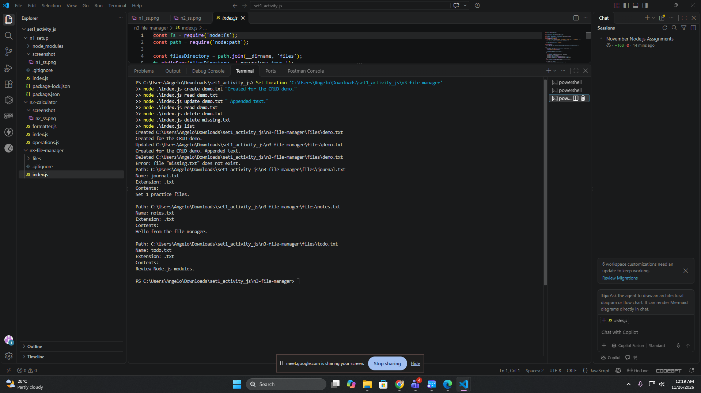

# ELEC3-Nodejs-DeVera

Full name: De Vera, John Angelo

Section: IV-BSIT C

Course code: ELEC 3 - Node.js

Course title: Node.js Programming

## Activities

| Activity | Description | Folder |
| --- | --- | --- |
| N1 | Project setup with npm, `package.json`, and the `lodash` and `nodemon` packages | [set1/n1-setup](set1/n1-setup/) |
| N2 | Modular calculator using custom modules, built-in modules, and `process.argv` | [set1/n2-calculator](set1/n2-calculator/) |
| N3 | File manager using the `fs` and `path` modules | [set1/n3-file-manager](set1/n3-file-manager/) |

## How to Run

Make sure Node.js and npm are installed.

### N1 - Project Setup

```powershell
cd set1/n1-setup
npm.cmd install
npm.cmd start
```

Prints a greeting. `lodash` is a regular dependency, and `nodemon` is a development dependency. The `node_modules/` folder is ignored; run `npm.cmd install` to install the packages.

### N2 - Modular Calculator

```powershell
cd set1/n2-calculator
node .\index.js add 12 8
node .\index.js divide 5 0
```

Supported operations: `add`, `subtract`, `multiply`, `divide`, and `average`. Each operation requires at least two valid numbers. Invalid operations and division by zero print a clear error.

Files: `index.js` reads the command-line arguments, `operations.js` exports the math functions, and `formatter.js` formats the result. The program also uses Node.js built-in `os` and `path` modules.

### N3 - File Manager

```powershell
cd set1/n3-file-manager
node .\index.js create notes.txt "Hello"
node .\index.js read notes.txt
node .\index.js update notes.txt "More text"
node .\index.js delete notes.txt
node .\index.js list
```

All files are stored in the `files/` folder. Use file names only; folder paths are not allowed. `create` fails if the file already exists, `update` appends text, and `list` displays each file's full path, name, extension, and contents. The `files/` folder includes three sample text files.

## Screenshots

### N1


### N2


### N3


