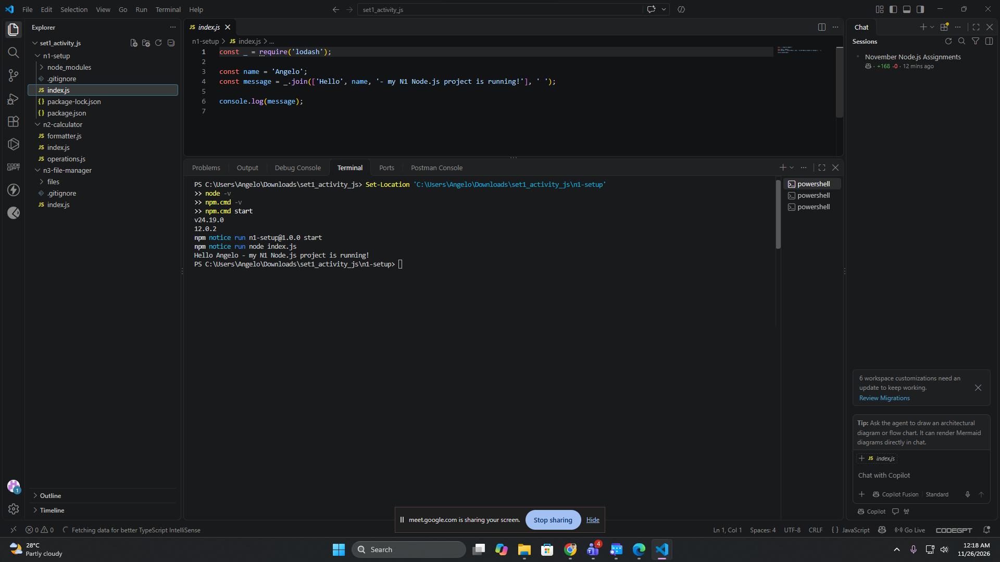
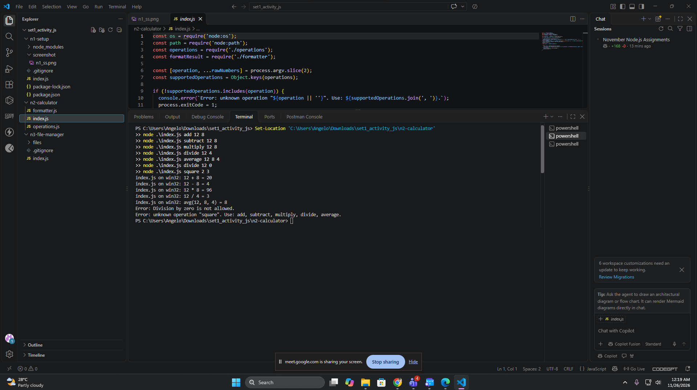

# ELEC 3 - Node.js Programming

**Name:** De Vera, John Angelo

**Section:** IV-BSIT C

**Course code:** ELEC 3 - Node.js

**Course title:** Node.js Programming

## Set 1 Activities

### N1 - Project Setup

An npm project demonstrating `package.json`, dependencies, and running a Node.js program.

**Files:** `index.js`, `package.json`

**Run:**

```powershell
cd set1/n1-setup
npm.cmd install
npm.cmd start
```

[View N1 files](set1/n1-setup/)

### N2 - Modular Calculator

A command-line calculator using custom modules, built-in Node.js modules, and `process.argv`. Supported operations are `add`, `subtract`, `multiply`, `divide`, and `average`.

**Files:** `index.js`, `operations.js`, `formatter.js`

**Run:**

```powershell
cd set1/n2-calculator
node .\index.js add 12 8
node .\index.js divide 5 0
```

[View N2 files](set1/n2-calculator/)

### N3 - File Manager

A file manager using Node.js `fs` and `path` modules. It supports `create`, `read`, `update`, `delete`, and `list`; managed files are stored in the activity's `files/` folder.

**File:** `index.js`

**Run:**

```powershell
cd set1/n3-file-manager
node .\index.js create notes.txt "Hello"
node .\index.js read notes.txt
node .\index.js update notes.txt "More text"
node .\index.js delete notes.txt
node .\index.js list
```

[View N3 files](set1/n3-file-manager/)

## Screenshots

### N1 - Project Setup



### N2 - Modular Calculator



### N3 - File Manager


